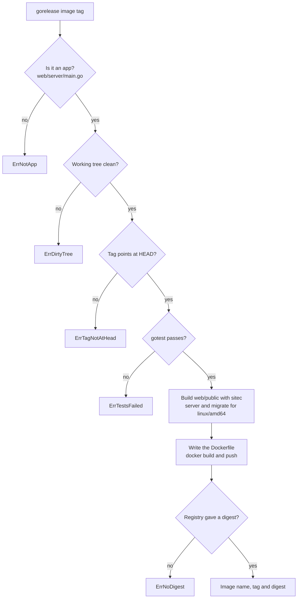

> Read AGENTS.md at the repo root before any change.
> **Finish by yourself:** when the delivery check passes, commit, push and open the pull request. Never ask whether to
> proceed or finalize — nobody answers, and a session that waits ends without your work.

# `gorelease image`

## Context

A self-hosted webtyp app is deployed as **one container image per version** (`docs/SELFHOST_DOCKER_DESIGN.md` in
`webtyp/docs`). The developer publishes from their own machine when a piece is ready — no CI. This plan adds the first
half: build the app's image and push it to the GitHub container registry, returning its **digest** (the fingerprint the
signed manifest will carry). The next plan adds the signed manifest, the `compose.yaml` and the GitHub Release.

A repo is a webtyp **app** when it has `web/server/main.go`. Its image holds (decision D27):

| Path in the image | Built from |
|---|---|
| `/app/server` | `./web/server` — the entrypoint |
| `/app/migrate` | `./cmd/migrate`, only if that folder exists |
| `/app/web/public` | the site, built in release mode by `webtyp.com/sitec` (the same call `goflare` makes) |
| `/app/certs` | an empty folder, so the volume that keeps the TLS certificate is owned by the app's user |

Working directory `/app`, non-root user, platform `linux/amd64`, Go binaries static (`CGO_ENABLED=0`).

## Tools

```bash
go install webtyp.com/devflow/cmd/gotest@latest
go get webtyp.com/sitec@v0.2.85
go mod tidy
```

Environment: `GOPRIVATE=webtyp.com/*,github.com/veltylabs/*`, `GOFLAGS=-mod=mod`. No test may run `docker`, `gh`,
`git`, `go build`, `gotest` or `sitec` for real: they all go through the injected functions below.

## Ecosystem search

- Building `web/public` for release: `sitec.BuildWithConfig` + `WriteTo(sitec.NewOsFS())` in `ModeRelease` — exactly
  what `goflare/build.go:129-145` does — **reuse**.
- Running commands: this repo already uses `webtyp.com/command`, but it cannot pass environment variables
  (`CGO_ENABLED`, `GOOS`, `GOARCH`); the default runner here uses `os/exec` directly (native-only tool, stdlib is fine).
- No repo builds or pushes container images: **new** capability, in `gorelease` (D42 of the app roadmap: «gorelease
  publishes the app»).

## Design gate

1. **Prior art.** `ko` builds Go images without a Dockerfile and pushes them by digest; GoReleaser's `dockers` section
   builds and pushes images per tag (unverified: pages not read in this session). Same: build from the repo, push,
   pin by digest.
2. **Novice names.** `gorelease image [tag]`, `gorelease.IsApp(dir)`, `(*Gorelease).BuildImage(tag, deps)`,
   `gorelease.Image{Name, Tag, Digest}`, `Image.Reference()`.
3. **Complexity ledger.** One new subcommand; CLI-only repos are unchanged (`gorelease [tag]` keeps cross-compiling `cmd/`).
4. **Where it belongs.** `gorelease`, the publisher.
5. **Deletes.** Nothing.

## APIs used

| Symbol | Exact signature | Tag |
|---|---|---|
| `sitec.BuildWithConfig` | `func BuildWithConfig(cfg BuildConfig) (*Output, error)`; `BuildConfig{RootDir string; Mode Mode; OutputDir string; AppName string; Log func(...any)}`; `sitec.ModeRelease`; `(*Output).WriteTo(fs)`; `sitec.NewOsFS()` — as used in `goflare/build.go:129-145` | `webtyp.com/sitec` v0.2.85 |
| `(*Gorelease)`, `GitClient.GetLatestTag` | as in `gorelease.go` | this repo |

If a signature differs, stop and name the symbol in the PR; never adapt it by guessing.

## Stage 1 — diagram `docs/diagrams/IMAGE_FLOW.md` (new)

````markdown
# Image flow

What `gorelease image` does. Every branch has a test in `tests/image_test.go`.


````

Commit.

## Stage 2 — tests first: `tests/image_test.go` (new, `package gorelease_test`)

Set up a temp repo dir with `web/server/main.go` (any content) and, where the row says so, `cmd/migrate/main.go`.
Deps: a fake `Run` that records each call as `dir|env|name args…` and answers from a table keyed by `name+" "+args[0]`
(`git status`, `git rev-parse`, `git rev-list`, `gotest`, `gh repo`, `go build`, `docker build`, `docker push`,
`docker inspect`), and a fake `Site` that writes `index.html` into its `outDir`. Defaults: clean tree (`git status`
→ ""), HEAD and tag on the same commit (`abc123`), `gh repo view` → `acme/Shop`, `docker inspect` →
`ghcr.io/acme/shop@sha256:<64 hex>`.

| Test | Fake | Expected |
|---|---|---|
| `TestImage_NotApp` | no `web/server/main.go` | `errors.Is(err, gorelease.ErrNotApp)`; nothing run |
| `TestImage_DirtyTree` | `git status` → `" M x.go"` | `ErrDirtyTree`; no `go build`, no `docker` |
| `TestImage_TagNotAtHead` | `git rev-list` → `def456` | `ErrTagNotAtHead` |
| `TestImage_TestsFail` | `gotest` → error | `ErrTestsFailed` wrapping it; no `docker` |
| `TestImage_Builds` | defaults, with `cmd/migrate` | returns `Image{Name: "ghcr.io/acme/shop", Tag: "v1.2.0", Digest: "sha256:<hex>"}` and `Reference() == "ghcr.io/acme/shop@sha256:<hex>"`; the two `go build` calls carry env `CGO_ENABLED=0`, `GOOS=linux`, `GOARCH=amd64` and outputs `<ctx>/app/server` from `./web/server` and `<ctx>/app/migrate` from `./cmd/migrate`; `docker build --platform linux/amd64 -t ghcr.io/acme/shop:v1.2.0 <ctx>` then `docker push ghcr.io/acme/shop:v1.2.0`; the Dockerfile written in `<ctx>` equals `dockerfile` (below) byte for byte; `<ctx>/app/web/public/index.html` and the empty dir `<ctx>/app/certs` exist when `docker build` runs (check them from inside the fake) |
| `TestImage_NoMigrate` | defaults, no `cmd/migrate` | exactly one `go build` |
| `TestImage_NoDigest` | `docker inspect` → `ghcr.io/acme/shop:v1.2.0` | `ErrNoDigest` |
| `TestImage_LatestTag` | tag `""`, `GetLatestTag` → `v1.2.0` | same image tag `v1.2.0` |

Commit (red).

## Stage 3 — `image.go` (new)

```go
package gorelease

import (
	"bytes"
	"errors"
	"fmt"
	"os"
	"os/exec"
	"path/filepath"
	"strings"

	"webtyp.com/sitec"
)

var (
	ErrNotApp       = errors.New("gorelease: not a webtyp app (no web/server/main.go)")
	ErrDirtyTree    = errors.New("gorelease: the working tree has uncommitted changes; commit or stash them first")
	ErrTagNotAtHead = errors.New("gorelease: the tag does not point at the current commit")
	ErrTestsFailed  = errors.New("gorelease: gotest failed; nothing was published")
	ErrNoDigest     = errors.New("gorelease: the registry did not report the image digest")
)

const (
	appServerEntry = "web/server/main.go"
	appServerPkg   = "./web/server"
	appMigrateDir  = "cmd/migrate"
	appMigratePkg  = "./cmd/migrate"
	appPublicDir   = "web/public"
	imageRegistry  = "ghcr.io/"
	imagePlatform  = "linux/amd64"
	ctxAppDir      = "app"
	ctxServer      = "server"
	ctxMigrate     = "migrate"
	ctxCerts       = "certs"
	dockerfileName = "Dockerfile"
	digestMark     = "@"
	digestPrefix   = "sha256:"
	inspectFormat  = "{{index .RepoDigests 0}}"
)

// dockerfile is the whole image: the built tree on a minimal non-root base.
const dockerfile = `FROM gcr.io/distroless/static-debian12:nonroot
WORKDIR /app
COPY --chown=65532:65532 app/ /app/
ENTRYPOINT ["/app/server"]
`

var crossEnv = []string{"CGO_ENABLED=0", "GOOS=linux", "GOARCH=amd64"}

// Image is a pushed container image, pinned by its digest.
type Image struct {
	Name   string // "ghcr.io/owner/repo", lower case
	Tag    string
	Digest string // "sha256:<hex>"
}

// Reference is what a server pulls: the image at its digest.
// Example: img.Reference() == "ghcr.io/acme/shop@sha256:…"
func (i Image) Reference() string { return i.Name + digestMark + i.Digest }

// AppDeps are the tools BuildImage runs. Tests replace them; nil uses the real ones.
type AppDeps struct {
	Run  func(dir string, env []string, name string, args ...string) (string, error)
	Site func(rootDir, outDir, appName string) error
}

// IsApp reports whether dir is a webtyp app (it has web/server/main.go).
// Example: if gorelease.IsApp(".") { … }
func IsApp(dir string) bool {
	_, err := os.Stat(filepath.Join(dir, appServerEntry))
	return err == nil
}

// BuildImage builds the app's image for tag (latest tag when empty) and pushes it.
// It refuses a dirty tree, a tag that is not HEAD, and failing tests.
// Example: img, err := g.BuildImage("v1.2.0", gorelease.AppDeps{})
func (g *Gorelease) BuildImage(tag string, deps AppDeps) (Image, error) {
	run, site := deps.run(), deps.site()
	root := g.rootDir
	if !IsApp(root) {
		return Image{}, ErrNotApp
	}
	if tag == "" {
		t, err := g.git.GetLatestTag()
		if err != nil {
			return Image{}, err
		}
		tag = t
	}
	if out, err := run(root, nil, "git", "status", "--porcelain"); err != nil {
		return Image{}, err
	} else if strings.TrimSpace(out) != "" {
		return Image{}, ErrDirtyTree
	}
	head, err := run(root, nil, "git", "rev-parse", "HEAD")
	if err != nil {
		return Image{}, err
	}
	tagged, err := run(root, nil, "git", "rev-list", "-n", "1", tag)
	if err != nil {
		return Image{}, err
	}
	if strings.TrimSpace(head) != strings.TrimSpace(tagged) {
		return Image{}, ErrTagNotAtHead
	}
	if _, err := run(root, nil, "gotest"); err != nil {
		return Image{}, fmt.Errorf("%w: %v", ErrTestsFailed, err)
	}
	repo, err := run(root, nil, "gh", "repo", "view", "--json", "nameWithOwner", "-q", ".nameWithOwner")
	if err != nil {
		return Image{}, err
	}
	repo = strings.ToLower(strings.TrimSpace(repo))
	name := imageRegistry + repo

	ctx, err := os.MkdirTemp("", "gorelease-image-*")
	if err != nil {
		return Image{}, err
	}
	defer os.RemoveAll(ctx)
	app := filepath.Join(ctx, ctxAppDir)
	if err := os.MkdirAll(filepath.Join(app, ctxCerts), 0o755); err != nil {
		return Image{}, err
	}
	if err := site(root, filepath.Join(app, appPublicDir), filepath.Base(repo)); err != nil {
		return Image{}, err
	}
	if _, err := run(root, crossEnv, "go", "build", "-trimpath", "-ldflags", "-s -w", "-o", filepath.Join(app, ctxServer), appServerPkg); err != nil {
		return Image{}, err
	}
	if _, err := os.Stat(filepath.Join(root, appMigrateDir)); err == nil {
		if _, err := run(root, crossEnv, "go", "build", "-trimpath", "-ldflags", "-s -w", "-o", filepath.Join(app, ctxMigrate), appMigratePkg); err != nil {
			return Image{}, err
		}
	}
	if err := os.WriteFile(filepath.Join(ctx, dockerfileName), []byte(dockerfile), 0o644); err != nil {
		return Image{}, err
	}
	ref := name + ":" + tag
	if _, err := run(ctx, nil, "docker", "build", "--platform", imagePlatform, "-t", ref, ctx); err != nil {
		return Image{}, err
	}
	if _, err := run(ctx, nil, "docker", "push", ref); err != nil {
		return Image{}, err
	}
	pinned, err := run(ctx, nil, "docker", "inspect", "--format", inspectFormat, ref)
	if err != nil {
		return Image{}, err
	}
	_, digest, ok := strings.Cut(strings.TrimSpace(pinned), digestMark)
	if !ok || !strings.HasPrefix(digest, digestPrefix) {
		return Image{}, ErrNoDigest
	}
	img := Image{Name: name, Tag: tag, Digest: digest}
	g.consoleOutput("✅ Image → " + img.Reference())
	return img, nil
}

func (d AppDeps) run() func(string, []string, string, ...string) (string, error) {
	if d.Run != nil {
		return d.Run
	}
	return runCommand
}

func (d AppDeps) site() func(string, string, string) error {
	if d.Site != nil {
		return d.Site
	}
	return buildSite
}

func runCommand(dir string, env []string, name string, args ...string) (string, error) {
	var out, stderr bytes.Buffer
	cmd := exec.Command(name, args...)
	cmd.Dir = dir
	cmd.Env = append(os.Environ(), env...)
	cmd.Stdout = &out
	cmd.Stderr = &stderr
	if err := cmd.Run(); err != nil {
		return out.String(), fmt.Errorf("%s %s: %w: %s", name, strings.Join(args, " "), err, strings.TrimSpace(stderr.String()))
	}
	return out.String(), nil
}

// buildSite builds web/public in release mode with sitec (as goflare does) and copies it to outDir.
func buildSite(rootDir, outDir, appName string) error {
	site, err := sitec.BuildWithConfig(sitec.BuildConfig{
		RootDir:   rootDir,
		Mode:      sitec.ModeRelease,
		OutputDir: appPublicDir,
		AppName:   appName,
	})
	if err != nil {
		return err
	}
	if err := site.WriteTo(sitec.NewOsFS()); err != nil {
		return err
	}
	return os.CopyFS(outDir, os.DirFS(filepath.Join(rootDir, appPublicDir)))
}
```

If `sitec.BuildWithConfig` writes relative to the process's working directory instead of `RootDir`, keep `rootDir`
as `"."` callers only (the CLI runs at the repo root) and say so in the PR; do not add a `chdir`.

## Stage 4 — CLI

In `cmd/gorelease/main.go`, before `ParseReleaseArgs`: `gorelease image [tag]` → build `git` as today, `g, err :=
gorelease.New(git)`, `img, err := g.BuildImage(tag, gorelease.AppDeps{})`, print errors to stderr and exit 1; on
success print `img.Reference()` to stdout and exit 0. Add the subcommand to the usage text: «image [tag] — build the
webtyp app's container image (linux/amd64), push it to ghcr.io and print it pinned by digest. Needs Docker and
`gh auth refresh -s write:packages` once.» Commit.

## Stage 5 — docs

`README.md` and `docs/GORELEASE.md`: a section «Apps: `gorelease image`» with the table of what the image holds, the
refusals (dirty tree, tag not at HEAD, failing tests), and the one-time `gh auth refresh -s write:packages` +
`gh auth token | docker login ghcr.io -u <user> --password-stdin`. Link `docs/diagrams/IMAGE_FLOW.md`. Commit.

## Delivery check

1. `gotest` passes; no test runs a real command. A PR that does not compile, or whose tests could not run, is a failed delivery.
2. `git diff --stat main` lists only `image.go`, `cmd/gorelease/main.go`, `tests/image_test.go`,
   `docs/diagrams/IMAGE_FLOW.md`, `README.md`, `docs/GORELEASE.md`, `go.mod`, `go.sum`.

## Delivery rules

- Commit after every stage. Never run `git reset`, `git restore`, `git checkout -- <file>` or `git stash` on your own work.
- Stuck for 30 minutes: open the PR anyway, listing what fails.
- Do not change `gorelease.go`, `action.yml` or the cross-compile path.

## Stages

| # | Files | Result |
|---|---|---|
| 1 | `docs/diagrams/IMAGE_FLOW.md` | The flow, one test per branch |
| 2 | `tests/image_test.go` | Every refusal and the full build; red |
| 3 | `image.go` | `BuildImage`; green |
| 4 | `cmd/gorelease/main.go` | `gorelease image [tag]` |
| 5 | `README.md`, `docs/GORELEASE.md` | Documented |
