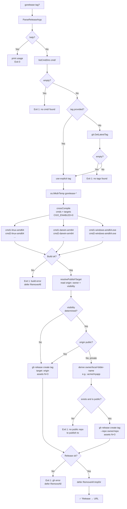
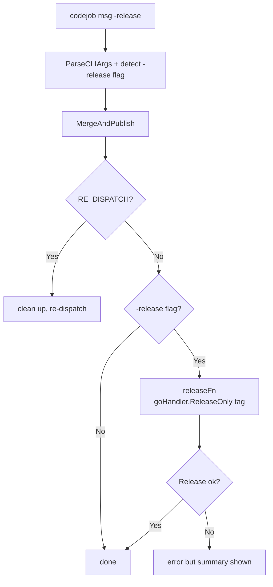

# gorelease Flow

Release-only workflow: reads an existing tag from git and creates a GitHub Release with
cross-compiled binaries. No tags are created, no commits made.



## Automatic publish repository resolution

`gorelease` takes no flags. It decides automatically:

```
visibility undetermined → publish to origin (compatible fallback)
origin public            → publish to origin (classic behavior)
origin private           → publish to  <owner-of-origin>/<local-folder-name>
                             (verify it exists and is public; if not, fail)
```

| Repo | Visibility | Role |
|------|-------------|-----|
| `acme/private-source` | Private | source + tags + history (= `origin`) |
| `acme/myapp` | Public | releases with binaries (local folder = `myapp`) |

You are in `~/work/myapp`, `origin` is `acme/private-source` (private).
Since a useful release cannot be published as private, `gorelease` derives `acme/myapp`
from the owner of `origin` + the local folder name, and publishes there.

## Output

```
✅ Release → https://github.com/acme/myapp/releases/tag/v0.2.13
```

## With codejob `-release` flag

`codejob 'msg' -release` runs the normal close-loop (gopush), then calls `gorelease`:



Tag created by `gopush` in MergeAndPublish is used immediately by `gorelease`.
